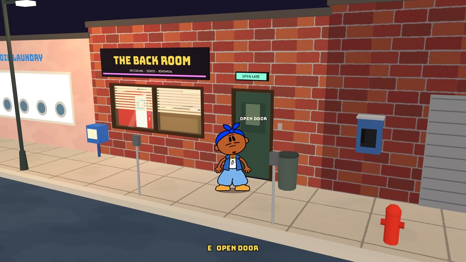
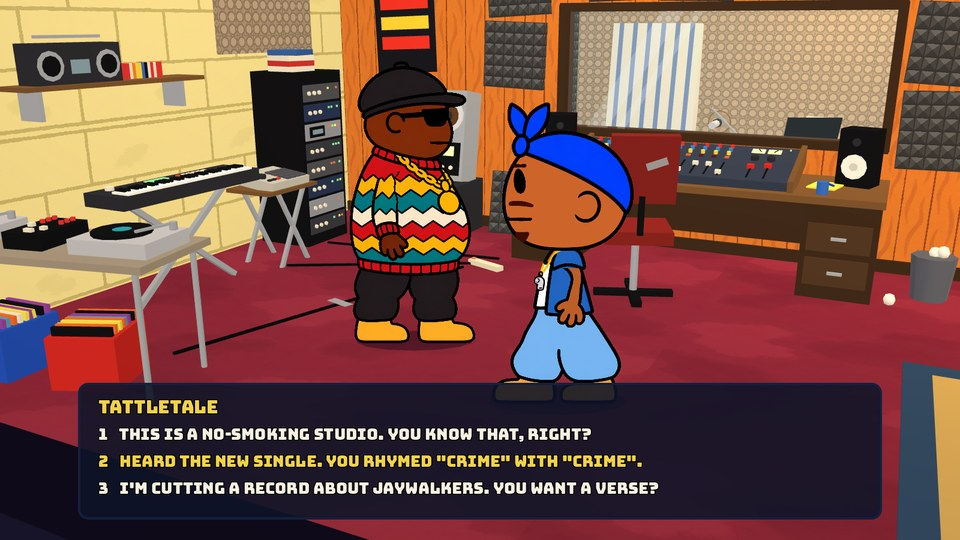

# Tattletale: pop-up prototype

A playable test of a new direction for Tattletale: flat paper characters in small low-poly sets. You walk a rapper round eight places in his neighbourhood: a small recording studio, the police station, the courthouse, his own house, a corner store, a liquor store, a friend's apartment and a hospital emergency department. It is a prototype. Large Fry is at the studio and at home and has a short conversation in each, with placeholder lines. A clerk stands behind each shop's counter, police officers stand about the station and the court's security lobby, and nurses work the hospital; they blink and watch you but have nothing to say yet.

## How to play

You need **Godot 4.7 or newer**, the standard build (not .NET), from https://godotengine.org/download. Nothing else: there is no build step.

Get this folder (on GitHub: Code, then Download ZIP, and unzip it; or `git clone`), then either:

- **In Godot:** open Godot, choose **Import**, pick `project.godot` in this folder, wait for the art to finish importing (well under a minute), and press **F5**.
- **On Windows:** double-click **PLAY.cmd**. It finds Godot if `godot` is on the PATH, if you put the Godot .exe in this folder, or if you write its full path in a file named `godot_path.txt` in this folder. It brings in the art first, then opens the game. The game opens maximized.
- **From a terminal, any system:** in this folder run `godot --headless --path . --import`, then `godot --path .`.

The art must be imported once before the game can show it. Opening the project in the editor does that, and so do PLAY.cmd and the `--import` command.

## Starting

The game opens on a title screen: **NEW GAME**, **CONTINUE** and **SETTINGS**. Pick with the mouse, or Up / Down and Enter.

- **New game** goes to a black screen with the lead in the middle, a little angel at one shoulder and a little devil at the other. While you have picked neither, his eyes go from one to the other, the camera drifts a little, and START is greyed out. Click one (or press Left / Right): its outline glows, gold and white for the angel, red for the devil, his eyes stay on it, and START can be pressed. Click it again to let go; Esc goes back to the title. START puts him on the street outside the studio. So far the choice is only remembered (it shows in the corner text); nothing in the places depends on it yet.
- The angel and the devil are never still, picked or not. Both blink, move their brows and stretch and squash a little. The angel hovers, beats his wings and raises and lowers his praying hands; the devil flicks his tail, lifts his pitchfork and sets it down, and bounces on his heels. The devil wears no whistle: it is the lead's badge of telling tales. Each is still one drawing; `shaders/paper_glow.gdshader` moves the parts, and `build_choice.py` (in the art folder) says where they are (`assets/ui/<name>.json`, `<name>_parts.png`).
- **Continue** is greyed out until there is a game to go back to. It returns him to the street outside the place he was last at. The game is kept in `save.json` in the Godot user folder, written when a new game starts and each time he travels.
- **Settings** has one switch so far: fullscreen on or off (kept in `settings.json`).

## Keys

| Key | Does |
|---|---|
| WASD / arrows | Walk. He starts on the pavement outside the studio, walks round the furniture and the other character, and the camera follows him |
| E | Use whatever is nearest and in reach: talk to someone, open or close a door, go up or down stairs, step up to the microphone in the studio's booth. Its name shows over it. A doorway can only be walked through while its door is open |
| 1 to 8 | Swap the lead between the character options (A to H). It starts on 5 (E), the only one with a walk cycle and loose face parts |
| Z / X | Previous / next expression (neutral, happy, grin, laugh, wink, calm, preachy, focused, angry, shout, sad, nervous, cringe, shocked, suspicious, side_eye, smug, bored) |
| Space (hold) | Move his mouth. If he has his back to you he turns round first |
| F | Close-up on / off (head to waist) |
| Tab | Next camera (follow, angle, angle_left, front, console, left, lounge, booth, top). In the studio only |
| C | Control-room ceiling on / off. In the studio only |
| M | The travel list: the places he can go. Click one or press its number and he arrives on the street outside it. M or Esc closes the list. There are eight: the studio, the police station, the courthouse, his house, the corner store, the liquor store, Large Fry's place and the hospital |
| F8 | Save a screenshot to the Godot user folder |
| Esc | Ends a conversation, steps away from the microphone, or backs out of a menu. Otherwise quits |

At the microphone (E beside it, in the booth): black bars slide in top and bottom, the camera watches him through the control-room window and drifts slowly from side to side, and he performs: his mouth goes, his knees dip on the beat, he rocks from foot to foot and his arms work. There is no sound yet. Esc steps away.

In a conversation: the box opens out from a thin line, then the things he can say are listed; the one under the mouse turns yellow. Click it, or press its number. E, Space, Enter or a click (on the box, its text, or anywhere else) finishes a line that is still typing, then moves on.

## The places

Press M to travel. He arrives on the pavement outside.

- **The Back Room**, the recording studio: described below.
- **Police station** (Pen Lucy Precinct): a worn old station house, 16 x 22 m. Lobby and the desk sergeant's office behind glass; the squad room and the captain's office; interview room, booking and the evidence cage; three cells, the drunk tank and the sally port at the back.
- **Courthouse** (district court): 18 x 22.5 m. Security lobby and the clerk's windows; a public hall and a lawyer room; one courtroom with the lockup and holding cell on one side and the jury room on the other; the judge's chambers and a records room behind.
- **Tattletale's crib**: a Baltimore rowhouse, 5 m wide. Living room, dining room, kitchen, back yard; press E at the foot of the stairs for his room, the bathroom and the back bedroom upstairs.
- **Corner store** (Miss Bea's Corner Grocery): the ground floor of the last house in a row, where two streets meet, 9 x 11 m. The shop, with the clerk behind plexiglass down the left side (the way in behind the counter is round its far end), coolers along the back wall and two runs of shelves; a back office and a stock room.
- **Liquor store** (Parkway Spirits): 10 x 12 m. The sales floor has the beer coolers, the wine and a stack of cases; the spirits are on a wall behind a sheet of plexiglass the width of the shop, reached by the steel door beside it; an office and a stock room behind.
- **Large Fry's place**: the ground-floor flat of an apartment block, 11 x 9.6 m, all on one floor and nothing like the crib. The block's entry hall (the lift is out of order) leads to his door; living room, kitchen, bathroom, bedroom. He is at home, wandering the living room, and will talk (he is also still at the studio).
- **Hospital** (the emergency department of Cator-Elkader Hospital): 18 x 18 m. Waiting room, triage and registration; a treatment room with three curtained bays and the nurses' station; a trauma room; the ambulance bay, a staff room and a supply room at the back.

Every door opens with E. Floor plans of the police station, the courthouse and the crib are drawn by `make_layouts.py` (in the full working folder: `../artifacts/flat-pivot-20261112/layouts/`).

## The studio

Four spaces in a row, going away from the camera, with a door between each pair:

    street  |  front room  |  control room  |  vocal booth

- **Street:** a strip of pavement in front of the shopfront ("THE BACK ROOM"), between the wall and the kerb, with a laundry and a pawn shop either side. You cannot step into the road.
- **Front room:** counter, waiting chairs, soda machine, rate card. The padded red door leads on.
- **Control room:** the board, the couch, and Large Fry, who stays in this room.
- **Vocal booth:** through the door in the back wall, right of the glass. The mic and the lyric stand are at the window, so whoever is at the mic faces the control room.

The camera always looks from the street side. When he goes through a doorway the picture dips to black for a moment, everything between the camera and his room is taken away, and the camera takes up its place for that room. The wall he came through is left as a low strip on the floor. Its door still stands there, whole but see-through, and how see-through depends on how near he is: from across the room it cannot be seen at all, and it comes into view as he walks up to it, so the doorway can be found and used from behind without the door ever covering the room. That goes for every door in every place (`door.gd`: `cut_away`, `show_near`). The booth's window wall is the exception: from inside the booth it stays as a faint see-through wall with its window and door frames solid, so you look in at him through the glass.

Walking is relative to the screen. A character shows a different drawing for each way he walks: front when he comes towards you, back when he walks away, side when he walks across (mirrored to walk left). Changing drawing flips the card over like a sheet of paper. Expressions, blinking and talking work from the front and from the side; the back has no face.

The game view is `follow`: off to the right and turned about 30 degrees, a fixed step from him. In a conversation it eases in on the two of them. `angle` is the same side standing still, with the whole room in frame.

The names `TATTLETALE` and `LARGE FRY` are working names, and the lines in `assets/data/talk_fry.json` are placeholders.

## Files

- `scripts/main.gd` is the scene: the building, the two characters, the cameras, the fade between rooms, the E key and the name tag.
- `scripts/building.gd` puts the rooms in a row and knows the floor plan. `rooms` lists them front to back, each with its floor and its camera numbers (how close, how high, how far right). `walls` lists the wall and door between each pair. `show_from(n)` shows room n and what is behind it. `walk_areas()` is everywhere someone may stand: each room's floor, plus each doorway whose door is open. To add a room, build its set, add a row to `rooms` and a `_wall(...)` to `walls`. A wall can leave a see-through copy behind when it is cut away (`walls[i]["ghost"] = _ghost_of(wall)`): the set marks each part of that wall with `set_meta("ghost", "wall")` (turns faint, `GHOST_WALL`) or `"keep"` (frames and glass, left solid); unmarked parts are left out. The back wall in `studio_set.gd` is the example.
- `scripts/street_set.gd`, `scripts/front_set.gd` and `scripts/studio_set.gd` build the street, the front room, and the control room with its booth, from boxes and cylinders. Sizes and positions are metres; move a prop by changing its numbers. `AREA` is the floor, and `OBSTACLES` lists the floor space each prop takes up, for walking round: if you move a prop, move its entry.
- `scripts/kit.gd` holds the helpers it uses (`box`, `block`, `cyl`, `disc`, flat colours, tiling textures).
- `scripts/flicker_check.gd` finds surfaces that lie exactly on one another (they flicker as the camera moves). Run it after moving walls, frames or anything flush with them: `python tools/shot.py out.png --check-faces`. A door or window frame must stand a little into its opening, never flush with the cut end of the wall.
- `scripts/door.gd` is a door that swings open and shut, for any door: put the node at the hinge and call `build_leaf(width, height, colour)` (or build your own leaf under `leaf`). `open_angle`, `open_time` and `shut_time` set the swing; `passage` is the floor that opens up with it (`building.gd` sets it). The three doors in `street_set.gd`, `building.gd` and `studio_set.gd` are the examples.
- **Anything E can be used on** has four things: `use_name()` (shown over it), `use_spot()` and `use_reach` (where and how near), `label_spot()` (where the name goes), and `use(by)`. Doors and characters have them; add the node to `_usables` in `main.gd`.
- `scripts/travel_menu.gd` is the travel list. The places are the `PLACES` table at the top of `main.gd`: a name, where he arrives, and `"built": false` for one that is listed but not there yet. `_travel_to(id)` in `main.gd` does the move.
- `scripts/place.gd` builds a place from a floor plan, and `scripts/plans/police.gd`, `court.gd` and `crib.gd` are the plans. A plan is written in metres as on a drawing (u from the left wall, v from the back wall): `room` lays a floor, `cross` and `side` put up walls with their doors and windows, `bars` and `rail` do cells and railings, and `prop` reserves floor for a piece of furniture. A building is a stack of bands from the street back, each band one or more rooms side by side; standing in a band, the bands nearer the street are hidden, as in the studio. A second floor is another stack, reached by a `portal` (`scripts/portal.gd`: the stairs); `Props.stairs` is the flight and `Props.stairwell` its top on the floor above, in a room whose floor has a `"hole"` there. The top of `place.gd` has the full list. To add a place: write a plan, add it to `PLANS` and `PLACES` in `main.gd`.
- `scripts/props.gd` is the furniture: desks, benches, shelves, cells, the courtroom pieces, kitchen and bedroom things, cars, street furniture. Each takes the place, the band, where on the plan, and which way it faces.
- After changing a plan, run both checks (below): `--check-walk` proves every room can still be walked to, `--check-faces` that nothing flickers.
- `scripts/paper_actor.gd` is the flat character card: which drawing to show, the walk cycle, and stopping at walls, props and other characters. His middle stays `REACH` (0.4 m) from anything beside him and `RADIUS` (0.26 m) from anything in front or behind, so his hands, feet and face never go into a wall or a counter; leave at least 0.85 m between two pieces of furniture he should walk between. Doorways are only a little wider than he is: pushing at an open one he is drawn into line with it (`_step`). Give it a `display_name` and it can be talked to.
- `scripts/wanderer.gd` walks a character about the floor on its own.
- `scripts/talk_box.gd` is the conversation box and runs a conversation from a table like `assets/data/talk_fry.json`: a node is either a list of things the player can say, or one line someone says. The format is at the top of the script. Text is in Bungee (`assets/fonts/`, with its licence, the SIL Open Font License; the font has capitals only).
- `shaders/paper_card.gdshader` moves the limbs inside a drawing without redrawing it: each leg is its own layer that can lift and swing, and each arm bends round its shoulder. The walk cycle in `paper_actor.gd` (`_pose`) only sets its numbers.
- `scripts/paper_face.gd` is the loose face: eyes, brows, mustache, goatee and mouth as small cards on the body card. It holds the expression table, blinks on its own, and flaps the mouth while `talking` is true. To add an expression, add a row to `EXPRESSIONS`: an eye drawing (or a different one per eye), a mouth, a brow, and where each brow sits. On the side profile it shows one eye, one brow and the profile version of the mouth (`parts/side_*.png`). The parts lie exactly on the body card and `shaders/paper_face.gdshader` draws them over it, so they cannot slide against the drawing when the camera is off to one side; a profile mouth runs under the head outline and the shader shows it only over skin, so the outline cuts it off cleanly.
- `assets/characters/e/` is the lead and `assets/characters/fry/` the second character: a drawing per view, `limbs*.png` (which pixels are arm), `legs*.png` (which leg each pixel below the hip belongs to), `parts/*.png` and `rig.json` (where everything sits, in pixels of the body drawing). They are written by two scripts, `build_lead.py` and `build_fry.py`, from the original drawings. Those scripts and drawings are not in this repository (in the full Tattletale working folder they are in `../artifacts/flat-pivot-20261112/tools/`): change the numbers there and run them again (lead first), then `python tools/shot.py --import`. Fry wears shades and a cap, so the only loose face part he shows is the mouth. The side-view mouths (`parts/side_*.png`) are made by `lead_views.profile_mouths`: each is cut to the inside of the head outline, and one that would touch the drawn mustache or goatee is moved up or made smaller until it does not. To check them without the game, paste each on the side drawing where `rig.json` puts it.
- `assets/textures` are 256 px tiles and `assets/characters/option_*.png` are single cut-out drawings. Both were made outside this repository (in the full working folder: `../artifacts/flat-pivot-20261112/`, with the briefs in `briefs/`, the raw images, and `tools/process_art.py`, which keys out the green background and shrinks the textures).

## Screenshots from the command line

For working on the game, not needed to play it. Needs Python 3. Run from this folder; Godot is found the way PLAY.cmd finds it. A screenshot window is a plain 1600 x 900 one on monitor 2 when there is one (`POPUP_MONITOR` picks another; 0 lets Godot choose); it never takes the keyboard and no console window opens, so it does not interrupt whoever is working on the main screen. `python tools/window_check.py out.png` proves it from Windows itself. Inside the full Tattletale working folder it waits for that project's one-Godot-at-a-time lock, so close the Pen Lucy game first.

    python tools/shot.py --import
    python tools/shot.py out.png --cam=angle --char=e
    python tools/shot.py out.png --char=e --close --face=angry
    python tools/shot.py out.png --char=e --at=-1.5,1.6 --walk=1,0,0.8
    python tools/shot.py out.png --at=-0.3,0.9 --fry-at=-1.4,0.5 --do=use,wait:1,hover:1
    python tools/shot.py out.png --at=2.2,-1.9 --do=use,wait:1.2
    python tools/shot.py out.png --do=use,wait:1,go:1.97:5.26,go:0.78:3.24,use,wait:1,go:0.75:1.76

`--walk=x,y,seconds` walks him that way on screen (x right, y towards you) before the picture is taken. `--at=x,z` puts him anywhere on the floor plan (without it he starts on the pavement). `--do=` runs steps after that: `use` (press E), `wait:seconds`, `hover:n`, `pick:n`, `next`, `clickbox` (a mouse click on the talk box), `walk:x:y:seconds` (hold an arrow key: a direction on screen), `go:x:z` (walk straight to that spot; walls, props and shut doors stop him), `travel`, `travelhover:n`, `travelpick:n` (the travel list), `key:M` (a real key press, by name). The last line printed says which room he ended in. `--eye=x,y,z,x,y,z` takes the picture from anywhere (camera position, then the point it looks at). `--check-faces` lists flickering surfaces (see `flicker_check.gd`); `0 overlapping pairs` is clean. `--place=police` (or `court`, `crib`) starts him at that place, `--room=BOOKING` stands him in the room of that name, and `--check-walk` opens every door and reports how much of each room he can reach: `python tools/shot.py out.png --place=court --check-walk --check-faces`.
