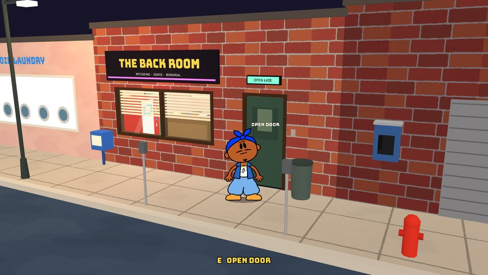

# Tattletale: pop-up prototype

A playable test of a new direction for Tattletale: flat paper characters in small low-poly sets. You walk a rapper round fifteen places in his neighbourhood: a small recording studio, the police station, the courthouse, his own house, a corner store, a liquor store, a friend's apartment, a hospital emergency department, a park with a full basketball court, a second park, a street of rowhouses, an old neighbour's house, a clothing store, a low-rent night club and the alley behind it. He can run, change his clothes, carry a pistol, an Uzi or an AK and fire it (windows break, people can be shot dead), and record a song and shoot a music video for money. It is a prototype. Large Fry is at the studio and at home and has a short conversation in each, with placeholder lines. A clerk stands behind each shop's counter, police officers stand about the station and the court's security lobby, nurses work the hospital, three young men hang about the court in the park and three rappers are out shopping; they blink and watch you but have nothing to say yet.

## How to play

You need **Godot 4.7 or newer**, the standard build (not .NET), from https://godotengine.org/download. Nothing else: there is no build step.

Get this folder (on GitHub: Code, then Download ZIP, and unzip it; or `git clone`), then either:

- **In Godot:** open Godot, choose **Import**, pick `project.godot` in this folder, wait for the art to finish importing (well under a minute), and press **F5**.
- **On Windows:** double-click **PLAY.cmd**. It finds Godot if `godot` is on the PATH, if you put the Godot .exe in this folder, or if you write its full path in a file named `godot_path.txt` in this folder. It brings in the art first, then opens the game. The game opens maximized.
- **From a terminal, any system:** in this folder run `godot --headless --path . --import`, then `godot --path .`.

The art must be imported once before the game can show it. Opening the project in the editor does that, and so do PLAY.cmd and the `--import` command.

## Starting

The game opens on a title screen: **NEW GAME**, **CONTINUE** and **SETTINGS**. Pick with the mouse, or Up / Down and Enter.

- **New game** goes to a black screen with the lead in the middle, a little angel at one shoulder and a little devil at the other. While you have picked neither, his eyes go from one to the other, the camera drifts a little, and START is greyed out. Click one (or press Left / Right): its outline glows, gold and white for the angel, red for the devil, his eyes stay on it, and START can be pressed. Click it again to let go; Esc goes back to the title. START puts him on the street outside the studio. So far the choice is only remembered (it shows in the corner text); nothing in the places depends on it yet.
- The angel and the devil are never still, picked or not. Both blink, move their brows and stretch and squash a little. The angel hovers, beats his wings and raises and lowers his praying hands; the devil flicks his tail, lifts his pitchfork and sets it down, and bounces on his heels. The devil wears no whistle: it is the lead's badge of telling tales. Each is one drawing cut into a body and its moving parts by `build_choice.py` (in the art folder): `assets/ui/<name>.png` is the body, `<name>_layer.png` the parts in colour, `<name>_parts.png` which part each pixel belongs to, `<name>.json` the pivots. `shaders/paper_glow.gdshader` moves each part as a stiff piece of card, behind the body or in front of it, so a wing or the pitchfork moving beside a face leaves the face alone. The choice is to become a crime-fighting playthrough (angel) or a criminal one (devil); nothing uses it yet.
- **Continue** is greyed out until there is a game to go back to. It returns him to the street outside the place he was last at. The game is kept in `save.json` in the Godot user folder, written when a new game starts and each time he travels.
- **Settings** has one switch so far: fullscreen on or off (kept in `settings.json`).

## Keys

| Key | Does |
|---|---|
| WASD / arrows | Walk. He starts on the pavement outside the studio, walks round the furniture and the other character, and the camera follows him |
| Shift (hold) | Run: nearly twice as fast, with quicker and longer steps, a lean, and arms that pump |
| Q | What he holds: nothing, a pistol, an Uzi, an AK, and round again |
| Right mouse button (hold) | Aim what he holds. A red cross comes up at the mouse and the pointer goes away; he turns to face the cross and the weapon points at it. Cross to his left or right: he turns side-on and tips the weapon up or down to it. Cross well below him: he faces us and it points out of the screen. Cross well above him: he turns his back to us and aims into the scene. If he walks a different way from the one he is aiming, he lowers it. Nothing happens without a weapon |
| Ctrl (hold) | Aim the way he is already facing, with no cross |
| Left mouse button | While he points it: fire. The pistol fires once a click; the Uzi and the AK keep firing while it is held. An empty gun clicks |
| R | Reload from his spare rounds: he dips the gun for a moment (pistol 1 s, Uzi 1.3 s, AK 1.6 s) |
| E | Use whatever is nearest and in reach: talk to someone, open or close a door, go up or down stairs, step up to the microphone in the studio's booth, try clothes at a rack in the clothing store, sleep in his bed. Its name shows over it. A doorway can only be walked through while its door is open |
| 1 to 8 | Swap the lead between the character options (A to H). It starts on 5 (E), the only one with a walk cycle and loose face parts |
| Z / X | Previous / next expression (neutral, happy, grin, laugh, wink, calm, preachy, focused, angry, shout, sad, nervous, cringe, shocked, suspicious, side_eye, smug, bored, scared, crying, hurt, disgusted, confused, embarrassed, guilty, pleading, dizzy, love, furious, innocent, sleepy, sly, content, lofty, beaming, bashful, teary, smitten, wince). One whose eyes cannot blink (a laugh, eyes shut) settles after a moment into its open-eyed face |
| Space (hold) | Move his mouth. If he has his back to you he turns round first |
| F | Close-up on / off (head to waist) |
| Tab | Next camera (follow, angle, angle_left, front, console, left, lounge, booth, top). In the studio only |
| C | Control-room ceiling on / off. In the studio only |
| M | The travel list: the places he can go. Click one or press its key (1 to 9, then 0, A, B, C, D, F) and he arrives on the street outside it. M or Esc closes the list. There are fifteen |
| F8 | Save a screenshot to the Godot user folder |
| Esc | Ends a conversation, steps away from the microphone, or backs out of a menu. Otherwise quits |

At the microphone (E beside it, in the booth): black bars slide in top and bottom, the camera watches him through the control-room window and drifts slowly from side to side, and he performs: his mouth goes, his knees dip on the beat, he rocks from foot to foot and his arms work. There is no sound yet. Esc steps away.

Sixteen beats at the microphone is a song recorded (a REC mark in the top corner counts them in; one song for each turn at the mic). A recorded song can have a music video: see **Music videos** below.

In a conversation: the box opens out from a thin line, then the things he can say are listed; the one under the mouse turns yellow. Click it, or press its number. E, Space, Enter or a click (on the box, its text, or anywhere else) finishes a line that is still typing, then moves on.

## Running, weapons, clothes and days

- **Running** (Shift) is the walk cycle driven harder, not a second set of drawings: the steps come 1.4 times as fast and reach further than he was drawn, he leans into it, and his arms bend at the elbow and pump (`paper_actor.gd`: `RUN`, `RUN_STEPS`, `_pose`).
- **Speed lines and dust.** At a sprint his hands keep their drawn shape: an arm bows at the elbow and the hand turns with the forearm as one piece, and the swing and pump stay modest (`paper_card.gdshader`: `arm_l_hand`; `paper_actor.gd`: `RUN_SWING`, `RUN_CURL`, `RUN_PUMP`, `RUN_BEND`). The speed is shown in flat ink instead (`speed_lines.gd`, `shaders/speed_lines.gdshader`): side-on, three tapered speed lines trail just behind him (following his lean, which is stronger at a sprint: `RUN_LEAN`), redrawn a dozen times a second so they flicker (the same flicker every run, so pictures compare); in every view a small inked puff of dust is kicked up at each step and left where it was, swelling and fading in a third of a second, never drawn over him (running away, it is pushed back along the line of sight to just behind him). Running at the camera or away from it there are only the puffs (strokes standing off his sides were tried and read as a start of fright). Nothing shows below a sprint. See it with `--do=sprint:1,walk:1:0:1.3`, or frame by frame with `--strip=none:e:s+f+b:8`.
- **Weapons** (Q, and the right mouse button to aim). A pistol and an Uzi are held in one hand, an AK in two. His arms are rubber hoses cut out of his drawing: each can turn at the shoulder, bow, and stretch along its length, and the game works out the turn and stretch that put his hand exactly on the grip. The hand itself is cut off at the wrist and a fist drawn with the weapon takes its place, tinted to his skin; the AK has a second fist under its handguard, which the other arm reaches. Side-on, where only one arm is drawn, the second arm comes out from behind his chest. Carrying, the weapon points at the ground ahead of him (a rifle across his chest from the front); aiming to one side, he turns side-on and the weapon tips up or down by up to about 35 degrees to follow the cross; aiming at us, the weapon is a second drawing of itself seen muzzle-on, held at his chest; (`assets/weapons/weapons.json`: `toward`; `scripts/crosshair.gd` draws the cross, `main.gd` `_aim_at` picks the view). Aiming away from us he turns his back (`back_point` in `HOLDS`, `AIM_AWAY` in `main.gd`): see "Aiming with his back to us" below. An earlier pose with the gun held up beside his head read as pointed at the sky and was dropped. Anyone whose drawing has cut-out arms can hold one: the lead, Large Fry and the six street characters. Someone in wide sleeves (a jersey, a puffer jacket) bends at the elbow to carry it, the sleeve staying as it was drawn, and lifts the whole arm from the shoulder to point it; wherever the cut end of an arm or the rim of a joint shows, it is inked.
- **Aiming with his back to us** (`AIM_AWAY` in `main.gd`). With the cross well above him he turns his back and points into the scene: both arms go forward, out of sight in front of him, and only his upper arms show at his sides, cut off at the elbow with a rounded, inked end (sleeves too: hoodie, puffer, flannel); nothing of the pistol, the Uzi or the AK shows (a sliver of the AK at his shoulder was tried and read as something held to his ear). He leans a little towards the cross, onto the foot on that side, which stays on the floor (`paper_actor.gd`: `HOLDS` `back_point` with `"elbows"`, `_elbows_out`, `ELBOW_CUT`, `ELBOW_ROUND`, `AWAY_BODY`, `AWAY_FOOT`; `shaders/arm_end.gdshaderinc` rounds the cut end). The weapon node still sits at his chest pointing up the screen with `aim_lean`, for a muzzle flash past his head. Going over the edge between side-on and his back does not flicker: `--do=weapon:pistol,aimsweep:2` swings the cross up over him and back, wavers it at the edge, and prints each turn (3 and 3 is right). See the pose with `--place=street --do=weapon:pistol,aimat:1100:150,wait:1`, or in a row with one weapon for each pose: `--lineup=pistol,uzi,ak,ak:e:bp+bp+bp+bpw` (add `--do=outfit:jacket=hoodie` for sleeves).
- **Shooting** (`scripts/combat.gd` and the `combat_*.gd` scripts beside it). A shot leaves the muzzle for whatever the red cross is over: a person first, then glass, then a wall or a prop; a wall between his chest and the muzzle takes the shot itself, so he cannot shoot through a wall he stands against. Shots go through anything drawn faint or with holes in its picture (chain link, a ghost wall). Automatics wander a little, more at a run. The rounds are the player state's (`loaded` and `spare`, kept in the save). Each shot puts a flat inked star at the muzzle for a frame or two with a quick warm light, kicks the gun and his arms, and throws a case out to the side that bounces and lies (40 at most, the oldest go first); where it lands, a puff and a mark on a wall, or sparks off anything thin and grey (a pole, a rail, a meter). **Glass** breaks where it is hit: a jagged hole with an ink edge, a light rim and cracks, and shards that fly and fall; hit again it opens wider, and after three hits only a fringe is left in the frame. A car's glass gets a dark hole with light cracks instead. Whatever builds a pane marks it with `Kit.pane(mesh)` (`place.gd`'s windows, `houses.gd`'s sashes, `Kit.window`, the studio's windows, the shop fronts, the corner store's plexiglass, cars), so a new place built from those has breakable windows. Broken glass stays broken while the place is loaded and is mended on a new day. **People** who are hit flinch with a hurt face; at 0 health they drop where they stand, flat on the floor, face up, eyes shut, and a pool of blood spreads from under them and stays. The dead do not walk, talk, blink or get in the way, and stay dead until he next sleeps (the save keeps them). Everyone within 18 m of a shot turns, looks scared and runs from him to the far side, facing the way they run, and cannot be talked to till they calm down; someone drawn from the front only can only run towards the camera, so when he is between them and the camera they cower where they are. Large Fry is a person like any other. **His health**: nothing shoots back yet; at 0 he wakes in the hospital's treatment room with full health and $500 less (both placeholders). The bottom-left corner (`combat_hud.gd`) shows his health, his cash, and what he holds with its rounds, loaded / spare; it is hidden on the title and choice screens, in a conversation and while a performance's bars are in.
- **The dead, the frightened and the held up** (`combat_people.gd`, with `people_cover.gd`, `people_flee.gd` and `people_back.gd`; where the Shooting paragraph above says otherwise about people, this is how it is now). The dead fall clear of anyone lying or standing there and lie with a cross over each eye (a pale one on each lens of dark glasses) and the tongue out, and nothing about them moves: no dance, step, bob, blink or mouth, and nothing left in their hands. Everyone within 18 m of a shot looks for somewhere out of his sight to hide: a spot they can walk to with something solid between it and his eyes, found from the place itself (its floor, its open doors, its furniture and walls), so a new place has hiding places with no more work: behind a counter, a car or a shelf, round a corner, or through a doorway into another room (a shut door they open on the way, and leave open). They run there, crouch, and stay until it has been quiet (no shot, no gun pointed) for 12 s, then walk back to where they were and carry on. If he comes round to where he can see someone hiding, that one runs for somewhere else; with nowhere to hide they run as far from him as they can get and cower there, and with nowhere to run either, where they are. Everyone faces the way they run: someone drawn only from the front turns their card about its upright, up to 65 degrees from facing us, and going away from us shows a back made from the front drawing (the face filled in with the hair colour); to cross the screen they zigzag, one side then the other. **Held up**: point a gun at someone near (6.5 m), in clear sight, who has not run yet, with the red cross on or close to them, and they freeze facing us, eyes on him, with their hands up (the clerk, the nurse and the cop, drawn in one piece, shrink instead); take the cross off them for 0.4 s, or fire, and they run for a hiding place. These numbers are placeholders, at the top of each script.
- **Clothes** are separate drawings, one for each garment, stacked over a bare body: a hat, a jacket, a shirt, trousers and shoes, each of which can be swapped for another cut and worn in several colours. The lead has seventeen (bandana, cap, beanie; vest, hoodie, puffer, flannel; tank, tee, jersey; baggy trousers, jeans, shorts, track trousers; boots, sneakers, high-tops) in all three views. In the **clothing store** each rack gives the next style of one piece (E) and its next colour (C); a hat or a jacket can also be left off; the tall mirror by the fitting rooms puts him back in his own clothes. What he has on is kept in the save. The six street characters are layered the same way, front view only, with twelve shared garments fitted to each body plus their own clothes and those of the others' that fit. Large Fry and everyone in uniform are still one drawing, recoloured by piece as before.
- **Days.** E at the bed in his room at the crib ends the day. Every day after the first, each street character puts on a different mix of garments and colours from their wardrobe (seeded by name and day), so nobody wears the same thing every day they are seen. Uniforms stay uniforms.

## The places

Press M to travel. He arrives on the pavement outside.

- **The Back Room**, the recording studio: described below.
- **Police station** (Pen Lucy Precinct): a worn old station house, 16 x 22 m. Lobby and the desk sergeant's office behind glass; the squad room and the captain's office; interview room, booking and the evidence cage; three cells, the drunk tank and the sally port at the back.
- **Courthouse** (district court): 18 x 22.5 m. Security lobby and the clerk's windows; a public hall and a lawyer room; one courtroom with the lockup and holding cell on one side and the jury room on the other; the judge's chambers and a records room behind.
- **Tattletale's crib**: a Baltimore rowhouse, 5 m wide. Living room, dining room, kitchen, back yard; press E at the foot of the stairs for his room, the bathroom and the back bedroom upstairs.
- **Corner store** (Miss Bea's Corner Grocery): the ground floor of the last house in a row, where two streets meet, 9 x 11 m. The shop, with the clerk behind plexiglass down the left side (the way in behind the counter is round its far end), coolers along the back wall and two runs of shelves; a back office and a stock room.
- **Liquor store** (Parkway Spirits): 10 x 12 m. The sales floor has the beer coolers, the wine and a stack of cases; the spirits are on a wall behind a sheet of plexiglass the width of the shop, reached by the steel door beside it; an office and a stock room behind.
- **Large Fry's place**: the ground-floor flat of an apartment block, 11 x 9.6 m, all on one floor and nothing like the crib. The block's entry hall (the lift is out of order) leads to his door; living room, kitchen, bathroom, bedroom. He is at home, wandering the living room, and will talk (he is also still at the studio).
- **Hospital** (the emergency department of Cator-Elkader Hospital): 18 x 18 m. Waiting room, triage and registration; a treatment room with three curtained bays and the nurses' station; a trauma room; the ambulance bay, a staff room and a supply room at the back.
- **Pen Lucy Park**: all out of doors, at night. A full 28 x 15 m basketball court, broadside to the camera, with every line and two hoops, under floodlights; bleachers, team benches, a scoreboard, a drinking fountain, bins; chain link round three sides and a low railing with a gate on the street. Behind it, across an alley, the backs of 27 rowhouses: back doors and steps, lit windows, yard fences, washing lines, aerials, garbage cans. Tre, Big Dee and Chuy are on the court.
- **Linden Square**: the second park, an old green square in the evening, 32 x 22 m, nothing like the first: iron railings and brick gate piers, flagstone paths meeting at a white bandstand, globe lamps, a lily pond with a fountain, picnic tables, stone chess tables, flower beds, and a playground in the back corner (swings, a slide, a roundabout, a climbing frame). Behind it the fronts of grand rowhouses, a stone church, a painted mural and a water tower.
- **THE LOWDOWN** (`club`, `scripts/plans/club.gd`, `props_club.gd`): a low-rent night club, dark. Out front a dead sign, a half-down shutter, a rope and a doorman; inside a main room (bar, DJ and light rig, dance floor with three dancers, torn booths, pool table, a dead arcade machine, a jukebox), toilets, a back hall and an office with a safe. The back hall's BACK DOOR goes to the back lot. Eight people, three to talk to (`talk_club_door.json`, `talk_club_bar.json`). Every name, sign, tag and line is a placeholder.
- **THE BACK LOT** (`alley`, `scripts/plans/alley.gd`, `props_alley.gd`): the alley down the club's back wall (dumpsters, a steaming grate, a loading door, a lookout on a crate, a sleeper and a burning drum at the dead end), a hole cut in the chain link to a vacant lot behind the row (a stripped car on blocks, tyres, a couch, rubble), and the stash room in the boarded-up house. Four people, three to talk to (`talk_alley_*.json`). The lot's front fence drops to a stub while the camera is behind it (`Alley.Cutaway`). Placeholders throughout.
- **Doors between places and people set by a plan.** A use point whose id is `goto:<place>` (`p.use_point(band, "BACK DOOR", x, z, "goto:alley", ...)`) takes him to that place, and he arrives at its `goto:` point back here (`main.gd` `_came_from`). A person in a plan may have `"dance": true` and `"beat": n` (dancing, as at the booth microphone, from that beat) and `"wear": {slot: item}` (dressed for that place, the same every day). Six people were added for these places: kesha, nia, vic, lil, ronnie, rell (`assets/characters/`, built by `places_npc.py` in the art tools).
- **Rose Hill Terrace**: a street to walk down at dusk, 57 m of it: a shorter copy of the Rose Hill Terrace block of the old Pen Lucy game. Porch-front rowhouses 516 to 532 in the old game's own colours, each with its three-sided upper bay; a paved strip, the pavement and the road, with parked cars to walk between; utility poles and wires; Old York Road crossing at one end. The houses have no insides.
- **Miss Bea's house**: an old neighbour's free-standing clapboard house, 9 x 11 m on two floors, lived in for forty years and unlike the crib and unlike Large Fry's flat: the front door opens at the foot of the stairs with the parlour through an arch beside it. A picket-fenced front yard and a full-width porch (a glider, rockers, hanging ferns); the parlour (a plastic-covered sofa, an upright piano with the family photographs, a console television) and the front hall; the dining room and the kitchen; a sun room and a pantry; upstairs (E at the stairs) her bedroom, a sewing room and a bathroom. Miss Bea herself is not there yet: she has no drawing.
- **Clothing store** (Fresh Threads): 10 x 11 m. A sales floor with a wall of hats, a rail of jackets, a wall of folded jeans, a sneaker wall, a table of shirts and a glass counter; fitting rooms with a three-way mirror; a stock room. Huff Daddy is shopping.

Out of doors nothing is hidden as he walks in: a park or a street is one room, in the street's own band. A place can be darker than the rest (`p.ambient`, `p.sun_energy` in its plan): the park is night, lit by its own lamps. The trees and shrubs are the old Pen Lucy game's own models (`assets/models/`, made from its plant templates by `make_plants.py` in the art folder's `borrow/`).

Every door opens with E. Floor plans of the police station, the courthouse and the crib are drawn by `make_layouts.py` (in the full working folder: `../artifacts/flat-pivot-20261112/layouts/`).

## The studio

Four spaces in a row, going away from the camera, with a door between each pair:

    street  |  front room  |  control room  |  vocal booth

- **Street:** a strip of pavement in front of the shopfront ("THE BACK ROOM"), between the wall and the kerb, with a laundry and a pawn shop either side. You cannot step into the road.
- **Front room:** counter, waiting chairs, soda machine, rate card. The padded red door leads on.
- **Control room:** the board, the couch, and Large Fry, who stays in this room.
- **Vocal booth:** through the door in the back wall, right of the glass. The mic and the lyric stand are at the window, so whoever is at the mic faces the control room.

The camera always looks from the street side. When he goes through a doorway the picture dips to black for a moment, everything between the camera and his room is taken away, and the camera takes up its place for that room. The wall he came through is left as a low strip on the floor. Its door still stands there, whole but see-through, and how see-through depends on how near he is: from across the room it cannot be seen at all, and it comes into view as he walks up to it, so the doorway can be found and used from behind without the door ever covering the room. That goes for every door in every place (`door.gd`: `cut_away`, `show_near`). The booth's window wall is the exception: from inside the booth it stays as a faint see-through wall with its window and door frames solid, so you look in at him through the glass.

Walking is relative to the screen. A character shows a different drawing for each way he walks: front when he comes towards you, back when he walks away, side when he walks across (mirrored to walk left). Changing drawing flips the card over like a sheet of paper. Expressions, blinking and talking work from the front and from the side; the back has no face.

The game view is `follow`: off to the right and turned about 30 degrees, a fixed step from him. In a conversation it eases in on the two of them. `angle` is the same side standing still, with the whole room in frame.

The names `TATTLETALE` and `LARGE FRY` are working names, and the lines in `assets/data/talk_fry.json` are placeholders. So are the names of the six street characters: `TRE`, `BIG DEE` and `CHUY`, and three parody rappers, `SNOOZY D`, `DOC DRAY` and `HUFF DADDY`, who are parodies of a type and of an era's clothes, not drawings of anyone. The lead no longer wears a whistle; his chain stays.

## Music videos

A song recorded at the booth microphone can have a music video. The camcorder on its tripod in the control room's front right corner starts one (E; with no song waiting it says to record one first). Everything a video says and every number it uses is in `assets/data/video.json`; the names, lines, captions and comments in it are placeholders.

- **Plan.** A board of cards, a row each for the location, the entourage, the bling, the cars, cash to throw and a smoke machine. Up and down choose a row, left and right a card (or click one); Enter shoots it; Esc leaves with nothing spent. The total is set against his cash, and the production meter shows how much the picks add to the look. Nothing is paid until the take is over.
- **Shoot.** He is taken to the location with what was bought around him (the entourage in matching hoodies, the cars parked, the bling on him) and Large Fry on camera. After a count-in the song runs for about 45 seconds: moves slide along the lane at the bottom, and pressing a move's key as it reaches the ring hits it on the beat: J point at the lens, K arms wide, L lean back, U flash the chain, I throw the cash, O throw it up, H aim at the lens. A move only comes up if he has what it needs (U bought bling with a chain in it, I cash to throw, H a weapon in his hand). Hits fill SWAGGER and the entourage copies him; on a miss they look lost. Large Fry's camera drifts, and A and D walk him along to stay in the frame. Two or three times a take something goes wrong: a homie walks into the lens, a car alarm goes off, Miss Bea comes out, the police drive by, the smoke machine takes over, the chain comes off. E in time deals with it (shove him out, kick the car, stop and take it, put it away or act natural, fan it, catch it) and keeps the take clean; let it go and it costs polish but adds CHAOS. Esc walks off the set: back to the studio, nothing spent. At CUT the whole plan is paid for.
- **Premiere.** Back in the studio: up to four moments caught during the take, each with a caption, then the stars, the views counting up, the comments and the pay. Enter goes on, Esc goes straight to the end; either way he is paid and the video is kept in the save (`player_state.gd`'s `videos`). The next song can have its own.

How it adds up (`video_score.gd`): the picks give **production**; **looks** is production, never more than his swagger, times polish; **buzz** is mostly looks, some swagger and some chaos; the views come from buzz through the `payout` table, give or take a little luck, and he is paid for each thousand views. Money buys the look and only the performance sells it: a free video outside the studio earns a few dollars, the dearest one performed well about twice what it cost, and performed badly almost nothing.

To add to it (all in `video.json`):

- **A location**: a card in the `location` row: `place` (an id from `PLACES` in `main.gd`), `price`, `adds` (to production) and `mark` (x, z: where he stands); and, from the mark, `camera` (x, height, z: the lens), `crew` (x, z each: where the entourage stand, as many as the biggest entourage) and `cars` (x, z and a heading in degrees each: where the cars park); `police` (the z the police car drives along) and `police_stop` (how far to his right it pulls up); `car_areas` if the cars or the entourage need floor nobody walks on, such as the road (x, z, x, z each). Then shoot a take there at a few seeds and look: as the camera drifts he walks along x, so keep lamp posts and benches off that line.
- **A move**: a row in `moves`: `id`, `name`, `key`, `face` (an expression), `arms` (shoulder turn and bow of each arm), `lean`, and optionally `beats` (how long it is held) and `needs` (`chain`, `rain`, `weapon`). Give it a caption, `"move:<id>"`, for the premiere.
- **A mishap**: a row in `mishaps` using one of the effects the take knows (`lens_hog`, `car_alarm`, `neighbour`, `police`, `smoke`, `chain_drop`), what it `needs` (`entourage`, `cars`, `chain`, `smoke`, `weapon`, `no weapon`, or nothing), its `name`, its `answer` (the key, what the prompt says, the polish and chaos it costs, the line said) and its `miss` (the same, if it is let go); and captions `"<id>:handled"` and `"<id>:missed"`. A new kind of trouble is code: its effect in `video_take.gd` (`_begin`, `_end_mishap`, and `LEAD`, how long it takes to come on).
- **A comment**: a row in `comments`: `who`, `text`, and `when`, tags that must all fit (none: any video). The tags: `looks:low`, `looks:high`, and the same for `swagger` and `chaos` (under and at or over `payout.levels`); `broke` and `rich` (spent up to `payout.broke`, at least `payout.rich`); `at:<location>`; `entourage:<choice>`, `bling:<choice>`, `cars:<choice>`; `rain`; `smoke`; `<mishap>:handled` and `<mishap>:missed`. Five are shown, the ones with the most tags first.

Steps for `--do=` (listed at the top of `video_shoot.gd`): `video:song`, `video:cash:9000`, `video:spot`, `video:plan`, `video:buy:dear` (or `cheap`, or `location=court+entourage=few`), `video:mishaps:police+car_alarm`, `video:seed:3`, `video:shoot`, `video:auto:0.9` (the take plays itself at that skill, 0 to 1), `video:key:J`, `video:walk:1`, `video:until:12` (a beat), `video:prompt`, `video:at:police`, `video:for:2`, `video:live:10` (ten seconds as in play: real time, real keys, which `key:J` presses), `video:premiere`, `video:next`, `video:results`, `video:done`, `video:esc`, `video:snap:name` (a picture saved beside the shot), `video:state`. The dearest video, played well, to its premiere:

    python tools/shot.py out.png "--do=video:song,video:cash:9000,video:spot,video:plan,video:buy:dear,video:shoot,video:auto:1,video:premiere,wait:2"

## Files

- `scripts/main.gd` is the scene: the building, the two characters, the cameras, the fade between rooms, the E key and the name tag.
- `scripts/building.gd` puts the rooms in a row and knows the floor plan. `rooms` lists them front to back, each with its floor and its camera numbers (how close, how high, how far right). `walls` lists the wall and door between each pair. `show_from(n)` shows room n and what is behind it. `walk_areas()` is everywhere someone may stand: each room's floor, plus each doorway whose door is open. To add a room, build its set, add a row to `rooms` and a `_wall(...)` to `walls`. A wall can leave a see-through copy behind when it is cut away (`walls[i]["ghost"] = _ghost_of(wall)`): the set marks each part of that wall with `set_meta("ghost", "wall")` (turns faint, `GHOST_WALL`) or `"keep"` (frames and glass, left solid); unmarked parts are left out. The back wall in `studio_set.gd` is the example.
- `scripts/street_set.gd`, `scripts/front_set.gd` and `scripts/studio_set.gd` build the street, the front room, and the control room with its booth, from boxes and cylinders. Sizes and positions are metres; move a prop by changing its numbers. `AREA` is the floor, and `OBSTACLES` lists the floor space each prop takes up, for walking round: if you move a prop, move its entry.
- `scripts/kit.gd` holds the helpers it uses (`box`, `block`, `cyl`, `disc`, flat colours, tiling textures).
- `scripts/flicker_check.gd` finds surfaces that lie exactly on one another (they flicker as the camera moves). Run it after moving walls, frames or anything flush with them: `python tools/shot.py out.png --check-faces`. A door or window frame must stand a little into its opening, never flush with the cut end of the wall.
- `scripts/door.gd` is a door that swings open and shut, for any door: put the node at the hinge and call `build_leaf(width, height, colour)` (or build your own leaf under `leaf`). `open_angle`, `open_time` and `shut_time` set the swing; `passage` is the floor that opens up with it (`building.gd` sets it). The three doors in `street_set.gd`, `building.gd` and `studio_set.gd` are the examples.
- **Anything E can be used on** has four things: `use_name()` (shown over it), `use_spot()` and `use_reach` (where and how near), `label_spot()` (where the name goes), and `use(by)`. Doors and characters have them; add the node to `_usables` in `main.gd`.
- `scripts/travel_menu.gd` is the travel list. The places are the `PLACES` table at the top of `main.gd`: a name, where he arrives, and `"built": false` for one that is listed but not there yet. `_travel_to(id)` in `main.gd` does the move.
- `scripts/place.gd` builds a place from a floor plan, and `scripts/plans/police.gd`, `court.gd` and `crib.gd` are the plans. A plan is written in metres as on a drawing (u from the left wall, v from the back wall): `room` lays a floor, `cross` and `side` put up walls with their doors and windows, `bars` and `rail` do cells and railings, and `prop` reserves floor for a piece of furniture. A building is a stack of bands from the street back, each band one or more rooms side by side; standing in a band, the bands nearer the street are hidden, as in the studio. A second floor is another stack, reached by a `portal` (`scripts/portal.gd`: the stairs); `Props.stairs` is the flight and `Props.stairwell` its top on the floor above, in a room whose floor has a `"hole"` there. The top of `place.gd` has the full list. To add a place: write a plan, add it to `PLANS` and `PLACES` in `main.gd`.
- `scripts/outdoor.gd` puts up the borrowed trees and shrubs (`Outdoor.tree`, `Outdoor.shrub`), repainted as they load in two bold greens with a shade of its own for each tree, and has the out-of-doors pieces the parks and the street share: textured pavement and road, see-through chain link, a dusk or night sky with a skyline (`backdrop`), moonlight. Its textures are `assets/textures/out_*.png` (made by `tex_out.py` in the art folder's `tools/`). On Rose Hill Terrace a parked car that comes between the camera and him fades to a ghost (`props_street.gd`'s `CarFade`).
- `scripts/sidewalk.gd` lays Rose Hill Terrace's ground (`plans/street.gd` calls it): concrete slabs one across, square to the kerb, a tooled joint about every 1.6 m with grime packed in it and a tar-filled expansion joint at each party wall; out-of-the-ordinary slabs by kind (`crack`, `stain`, `gum`, `heave`, `lift`, `sunk`, `split`, `half`, `patch`, `brick`, an empty tree `pit`, `drive`); each house's own front strip (`yard`, `turf`, `brick`, `paint`, plain) and the dark footing where its porch or stoop meets it; a granite kerb in stones with a storm drain's mouth, a concrete gutter with its wet line, the grate, kerb-cut ramps with their red pads; on the road, patches sealed round with tar, sealed cracks, manholes, oil, worn paint. All of it lies flat, so it never changes where anyone can walk. Between `begin()` and `end()` its boxes are gathered by look and by 10 m square into one mesh each (the street draws about as fast as before it had them); with `--check-faces`, or a `check` step, they stay separate boxes so the check can see them. Its pictures (`out_concrete`, `out_slab_*`, `out_granite`, `out_asphalt_old`, `out_asphalt_patch`, `out_dead_grass`, `out_turf`, `out_dirt`, `out_tactile`, `out_tread`, `out_lid`) are `tex_out.py`'s; `python tex_out.py out_concrete out_turf` remakes only those (set `POPUP_DIR` to this folder).
- `scripts/props_in.gd` dresses the insides and fronts of the indoor places: two-tone walls with rails and skirtings (`dress`, `room_walls`), floor borders and mats, lights (`strip_light`, `pendant`, `sconce`, `chandelier`), things on walls (pictures, a lightbox, pegboards, a camera), and pieces of street front (`cornice`, `quoins`, `front_window`, `parapet`, `column`, `pediment`). Its textures are `assets/textures/in_*.png` (`tex_in.py`); `kit_*.png` (`tex_kit.py`) are the studio's brick, wallpaper and quilted booth wall. `kit.gd` gained `bevel`, `bevel_block`, `tube`, `prism`, `awning` and `window`. `place.gd`'s `fence` is a railing, chain link or board fence with gateways, and `use_point` (`scripts/use_point.gd`) is a spot on the floor E can be used at for anything that is not a door, a person or stairs: `main.gd`'s `_use_point` acts on its id (`outfit:hat`, `outfit:reset`, `sleep`). The newer places keep their own furniture in `scripts/props_<place>.gd`.
- `scripts/houses.gd` is the outside of every home: one kit with the old Pen Lucy game's rowhouse facts (its brick, formstone and trim colours, cornices, three-sided bays and oriels, marble stoops, porch fronts, roofs, taken from `blender/city/kits.py` in the old game's repository). `Props.rowhouse` and the home plans (crib, Miss Bea's, Large Fry's block, both parks, Rose Hill Terrace) all build through it, so a change there changes every home's outside.
- `scripts/props.gd` is the furniture: desks, benches, shelves, cells, the courtroom pieces, kitchen and bedroom things, cars, street furniture. Each takes the place, the band, where on the plan, and which way it faces.
- After changing a plan, run both checks (below): `--check-walk` proves every room can still be walked to, `--check-faces` that nothing flickers.
- `scripts/paper_actor.gd` is the flat character card: which drawing to show, the walk cycle, and stopping at walls, props and other characters. His middle stays `REACH` (0.4 m) from anything beside him and `RADIUS` (0.26 m) from anything in front or behind, so his hands, feet and face never go into a wall or a counter; leave at least 0.85 m between two pieces of furniture he should walk between. Doorways are only a little wider than he is: pushing at an open one he is drawn into line with it (`_step`). Give it a `display_name` and it can be talked to.
- **Holding things** is in `paper_actor.gd` too. `HOLDS` is the table of how each weapon is held for each way he faces, carrying and pointing: where the fist on the grip goes from the shoulder (in arm lengths), the weapon's angle, how much each arm bows, which arm holds, and what is drawn over what. `_hold` turns that into arm angles each frame. The weapons and their fists are drawn in code by `build_weapons.py` (in the art folder's `tools/`) into `assets/weapons/`, with `weapons.json` giving each one's grip, second-hand, butt and muzzle points; `shaders/paper_prop.gdshader` draws them. A character whose build needs its own numbers for a hold (a big belly, short arms) has them in `assets/weapons/holds_for.json`, laid over `HOLDS`. To judge the holds, `python tools/holds_sheet.py <folder>` photographs every one (see `--lineup` below); add `--point` for the aims at the camera, away from it, and tipped up and down. A hold's row may also say `art` (which drawing of the weapon: `toward`, `away`), `behind` (weapon and fists go behind his body card), `arms_under` (so do his arms) and `flip`; an arm that goes behind him is not drawn for its first stretch from the shoulder, and its ends are inked.
- **Clothes**: `set_outfit({piece: Color})` on a paper actor. The pieces a drawing has are listed in its `rig.json` (`clothes`: the colour each was drawn in), with a `regions*.png` beside each view saying which pixels belong to which piece (`outfit.py` in the art folder's `tools/` makes them, and measures the arms: `arms` in `rig.json`). The colours on the racks are `WARDROBE` in `main.gd`.
- **Layered clothes**: a character with a `wardrobe.json` beside its `rig.json` is dressed from layers instead (`has_wardrobe()`, `wear({slot: {"item": id, "colour": Color}})` in `paper_actor.gd`). `wardrobe.json` lists the stacking `order`, the bare `base` for each view, what the original drawing `worn`, and the `items`: each with its `slot`, `name`, the `colour` it was drawn in, the `colours` it comes in, and for each view an `art` picture (the part that does not move with an arm) and, front and back, an `arms` picture (the sleeves). `_restack` lays them into the card's pictures once for each combination and keeps the result; a colour change is the old repaint by piece, which keeps anything drawn lighter than the cloth (stripes, numbers, soles, sparkles) as it was. Under a jacket with sleeves the shirt's sleeves are left out and its body is cut to the jacket's width row by row (`_cut_to`), so none of it shows past the jacket. Off his arms the card draws the stacked picture without them (`under`), so no hair of an arm's outline is left where the arm hung when he holds something. A pair that does not fit cleanly is left off by name in `wardrobe_fit.py`'s `PAIRS_OFF`, with the reason. The drawings are made by `wardrobe.py` and its helpers in the art folder's `tools/` (`wardrobe_items.py` draws the shared garments, `wardrobe_fit.py` fits one character's clothes to another's body); the contract is `briefs/wardrobe.md` there. Run `python tools/shot.py --import` after rebuilding. If a base picture cannot be read the wardrobe is not used and the character is as drawn. Test steps: `outfit:jacket=hoodie,hat=cap#226622` (`outfit:` alone undoes it) and `stand:outfit:hat` (stand at that rack).
- `scripts/wanderer.gd` walks a character about the floor on its own.
- `scripts/combat.gd` is the shooting: the left mouse button and R, the rounds, where a shot goes, his health and the hospital, and its `--do` steps and `combatcheck`. The numbers for each gun are `GUNS` at its top. `combat_world.gd` works out what a shot hits from the meshes themselves (nothing in the places has a collider); `combat_fx.gd` draws the flashes, cases, puffs, marks, sparks, shards and blood, each from a pool with a cap (`CAPS`), so a long burst makes nothing new; `combat_glass.gd` breaks panes; `combat_people.gd` is people being hit, falling, bleeding, fleeing and staying dead; `combat_hud.gd` is the bottom-left corner. `paper_actor.gd`'s `gun_points()` says where the muzzle and the ejection port of what he holds are in the world (from `weapons.json`).
- `scripts/people_cover.gd` finds hiding places: the floor anyone may stand on (the place's `walk_areas()` and every doorway in its `doors`, shut or not, less its `obstacles`, grown for their size) laid on 0.2 m squares, a flood from where someone stands (never passing close to the shooter, or through someone crouched), the squares beside something they cannot walk through that lies towards the shooter, and the likeliest of them tried with `combat_world.gd`'s traces from his eyes to the crouched head, its sides and its middle; the work is spread over frames (`BUDGET`). A part of the place the camera has cut away counts as out of his sight. `people_flee.gd` is the brain of someone frightened (following the way, turning in place first, crouching, hands up); `people_back.gd` turns a front-only card about its upright and makes its back (`back_mask.png` and `"back"` in its `rig.json`, made by `people_backs.py` in the art folder's `tools/`). The crossed-out eyes are `parts/eye_x.png` and `eye_x_pale.png` in each character (drawn by `face_parts.py`, stored and placed by `people_dead_eyes.py`); the held `"dead"` face is `HELD` in `paper_face.gd`.
- `scripts/talk_box.gd` is the conversation box and runs a conversation from a table like `assets/data/talk_fry.json`: a node is either a list of things the player can say, or one line someone says. The format is at the top of the script. Text is in Bungee (`assets/fonts/`, with its licence, the SIL Open Font License; the font has capitals only).
- `shaders/paper_card.gdshader` moves the limbs inside a drawing without redrawing it: each leg is its own layer that can lift and swing, and each arm bends round its shoulder. The walk cycle in `paper_actor.gd` (`_pose`) only sets its numbers.
- `scripts/paper_face.gd` is the loose face: eyes, brows, mustache, goatee and mouth as small cards on the body card. It holds the expression table, blinks on its own, and flaps the mouth while `talking` is true. To add an expression, add a row to `EXPRESSIONS`: an eye drawing (or a different one per eye), a mouth, a brow, and where each brow sits; optionally `"fx"`, the extras it shows (a sweat drop, tears, a blush, an anger mark: the `FX` table), and `"talk"`, which set of mouths it talks with (plain, happy, angry, sad, scared, sly). The parts themselves are drawn in code by `face_parts.py` in the art folder's `tools/`. On the side profile it shows one eye, one brow and the profile version of the mouth (`parts/side_*.png`). The parts lie exactly on the body card and `shaders/paper_face.gdshader` draws them over it, so they cannot slide against the drawing when the camera is off to one side; eyes, brows, mouth, tears and blush are shown only over bare skin in every view, so a lifted brow goes under a hat and a profile mouth is cut off cleanly by the head outline.
- **Faces at rest.** Nobody stands about with eyes that cannot blink. An expression whose eyes are a drawing that cannot blink (shut, a laugh's arcs, hearts, spirals, squeezed shut: anything not in `BLINKING_EYES`) is a moment, not a face to rest on: its row in `EXPRESSIONS` names a `"rest"`, the open-eyed expression of the same mood (calm: content; preachy: lofty; grin and laugh: beaming; wink: smug; embarrassed: bashful; crying: teary; hurt: wince; dizzy: confused; love: smitten). Left on someone who is not talking for `SETTLE` (1.5 s), a moment settles into its rest by itself, the eyes opening as from a blink, and blinks from then on. Talking (a line in a conversation, the booth) keeps it, so the talk reactions and the performance are as they were. `face.expression` is what is on show, `face.asked` what was last asked for (Z / X step from that); `face.hold = true` keeps a moment as it is, for someone asleep or out cold (and `--face=` stills). People are placed with open-eyed faces; `--check-faces` counts any who are not (`scripts/face_check.gd`) and proves on each of them that every moment settles.
- `assets/characters/e/` is the lead and `assets/characters/fry/` the second character: a drawing per view, `limbs*.png` (which pixels are arm), `legs*.png` (which leg each pixel below the hip belongs to), `parts/*.png` and `rig.json` (where everything sits, in pixels of the body drawing). They are written by two scripts, `build_lead.py` and `build_fry.py`, from the original drawings. Those scripts and drawings are not in this repository (in the full Tattletale working folder they are in `../artifacts/flat-pivot-20261112/tools/`): change the numbers there and run them again (lead first), then `python tools/shot.py --import`. Fry wears shades and a cap, so the only loose face part he shows is the mouth. The side-view mouths (`parts/side_*.png`) are made by `lead_views.profile_mouths`: each is cut to the inside of the head outline, and one that would touch the drawn mustache or goatee is moved up or made smaller until it does not. To check them without the game, paste each on the side drawing where `rig.json` puts it.
- `assets/textures` are 256 px tiles and `assets/characters/option_*.png` are single cut-out drawings. Both were made outside this repository (in the full working folder: `../artifacts/flat-pivot-20261112/`, with the briefs in `briefs/`, the raw images, and `tools/process_art.py`, which keys out the green background and shrinks the textures).

## Screenshots from the command line

For working on the game, not needed to play it. Needs Python 3. Run from this folder; Godot is found the way PLAY.cmd finds it. A screenshot window is a plain 1600 x 900 one on monitor 2 when there is one (`POPUP_MONITOR` picks another; 0 lets Godot choose); it never takes the keyboard and no console window opens, so it does not interrupt whoever is working on the main screen. `python tools/window_check.py out.png` proves it from Windows itself. Inside the full Tattletale working folder it waits for that project's one-Godot-at-a-time lock, so close the Pen Lucy game first.

    python tools/shot.py --import
    python tools/shot.py out.png --cam=angle --char=e
    python tools/shot.py out.png --char=e --close --face=angry
    python tools/shot.py out.png --char=e --at=-1.5,1.6 --walk=1,0,0.8
    python tools/shot.py out.png --at=-0.3,0.9 --fry-at=-1.4,0.5 --do=use,wait:1,hover:1
    python tools/shot.py out.png --at=2.2,-1.9 --do=use,wait:1.2
    python tools/shot.py out.png --do=use,wait:1,go:1.97:5.26,go:0.78:3.24,use,wait:1,go:0.75:1.76

`--strip=weapons:rigs:views[:frames]` photographs the sprint, which cannot be caught in one picture: each character runs on a plain backdrop and is frozen at `frames` evenly spaced points of one run cycle (two steps), seen square-on and close, one sheet for each rig, weapon and view (s side, m side facing left, f front, b back) beside the shot at 500 pixels to the metre, `<shot>_<rig>_<weapon>_<view>.png`, and all of them small in the shot itself (`scripts/run_strip.gd`). `python tools/shot.py run.png --strip=none+ak:e:s+f+b:8`; add `--do=outfit:jacket=hoodie` to run in other clothes. `chars_strip_crops.py` in the art folder's `tools/` lays one sheet's frames out cropped and enlarged. With `--check-faces` the last lines say how many people here rest on a face that cannot blink (it must be 0) and whether every moment settles.

`--lineup=weapon:rig:pose+pose` stands one character (or several: `tre,dee,chuy`) in a row on a plain backdrop, one for each pose, to judge how something is held: a pose is s, f or b (side, front, back), then c, a or p (carrying, pointing across the screen, pointing along the line of sight: at us from the front, away from the back), then optionally m, w, r, u or d (mirrored, mid-walk, mid-run, side aim tipped up, tipped down); the weapon may be `none`. More steps for `--do=`: `weapon:ak` (or `none`), `aim:1`, `aimat:x:y` (the red cross at that pixel of the screen), `sprint:1`, `face:side` (or `front`, `back`, `left`), `wear:hat:#cc2222` (`wear:` alone undoes it), `day:3`, `arm:TRE:ak:aim` (arm someone else there), `expr:laugh` or `expr:CHUY:calm` (an expression set as the game sets one, so a moment settles; `--face=` holds it for a still).

Shooting steps for `--do=`: `fire` or `fire:6` (he brings it up and fires that many, as fast as the gun goes, at the red cross if there is one, else along the barrel), `reload` (`reload:start` does not wait for it), `hurt:40`, `shoot:TRE:3` (the cross on someone, by name, or `someone`, the nearest; or `window`, a pane in sight; or `car`, a car's glass; then that many shots), `aimon:TRE` (the cross on it, no shot), `hud:0` / `hud:1`, `freeze` (what is flying stops where it is), `combatcheck` (a window broken, someone put down with a pool under him, the rounds and the HUD checked; it prints its problems; if nobody can be shot at from where he arrives it stands him in the nearest one's room, then beside them). In `--lineup` an `x` in a pose catches him firing: `--lineup=ak:e:sax+samx+saux+sadx+fpx+bpx`. In a screenshot the shooting runs at a fixed 1/60 s a frame, and frames come faster than that, so time anything it does with `frames:n` rather than `wait:` (a wait is real time): `python tools/shot.py out.png --place=park --do=weapon:pistol,shoot:TRE:3,frames:300 --eye=-3.0,2.4,-6.6,-4.6,0.2,-9.8`.

People steps for `--do=` (`scripts/people_steps.gd`): `hidecheck` stands him in the room with the most people, fires into the air, waits until everyone has hidden (10 s at most), and prints where each one ended up and whether he can see them from where he stands (`0 problems` is clean; `hidecheck:here` fires where he is; anyone still going is followed for 3 s more, with what holds them up); `runcover:name` is a picture of someone part-way to their hiding place, `hidden:name` one of someone hiding (with him in it), `gunpoint:name` walks him up to the nearest person and points at them (a picture with their hands up; then the cross goes off them and it prints what they do); `deadrow:name` stands every character with the dead face in rows on a plain backdrop, then lays them down (`name.png`, `name_lying.png`); `deadcheck:name` puts everyone here down at once, the dancers too, and watches two seconds of frames: it prints anyone who moves. `python tools/shot.py out.png --place=club --do=room:MAIN_ROOM,hidecheck`.

Many pictures in one run, from anywhere, in more than one place (`scripts/shot_steps.gd`): `snap:name` saves a picture then and there, as `name.png` beside the `--shot` file, and the run carries on; `eye:x:y:z:x:y:z[:fov]` takes the later pictures from that point looking at the second (`eye:` alone goes back to following him); `place:park` goes there at once; `at:x:z` stands him on that spot; `room:BAR` stands him in the middle of that room; `beat:2` holds everyone dancing at that step of their dance; `stats` prints the draw calls, the meshes in the place and the milliseconds a frame (timed with vsync off); `check` runs `--check-walk` and `--check-faces` on the place he is in now. For example, the Rose Hill pavement from both ends and from above, then the park:

    python tools/shot.py out.png --place=street --do=snap:arrive,eye:27:1.7:6.2:0:0.2:3.6:55,snap:low,eye:4:7.5:12:4:0:3.2:50,snap:top,eye:,place:park,snap:park

`--walk=x,y,seconds` walks him that way on screen (x right, y towards you) before the picture is taken. `--at=x,z` puts him anywhere on the floor plan (without it he starts on the pavement). `--do=` runs steps after that: `use` (press E), `wait:seconds`, `hover:n`, `pick:n`, `next`, `clickbox` (a mouse click on the talk box), `walk:x:y:seconds` (hold an arrow key: a direction on screen), `go:x:z` (walk straight to that spot; walls, props and shut doors stop him), `travel`, `travelhover:n`, `travelpick:n` (the travel list), `key:M` (a real key press, by name). The last line printed says which room he ended in. `--eye=x,y,z,x,y,z` takes the picture from anywhere (camera position, then the point it looks at). `--check-faces` lists flickering surfaces (see `flicker_check.gd`); `0 overlapping pairs` is clean. `--place=police` (or `court`, `crib`) starts him at that place, `--room=BOOKING` stands him in the room of that name, and `--check-walk` opens every door and reports how much of each room he can reach: `python tools/shot.py out.png --place=court --check-walk --check-faces`.
